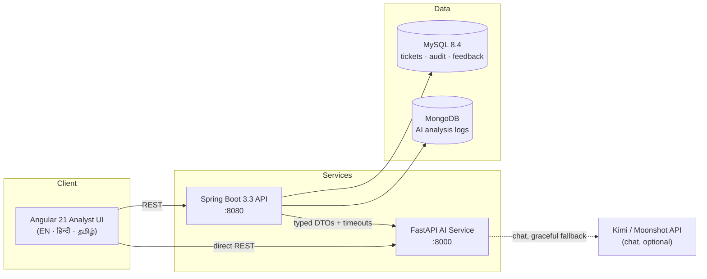

# 🛡️ TicketIQ — Evidence-Gated IT Support Resolution Copilot

**Retrieval + Verification + Human Control + Continuous Knowledge Improvement.**


TicketIQ is an AI-assisted, **analyst-controlled** platform for IT Application Maintenance & Support.
An analyst pastes an unstructured ticket — TicketIQ redacts PII, detects the language (English / हिन्दी / தமிழ்),
retrieves the **three most relevant approved knowledge-base runbooks**, and drafts a resolution where
**every step cites its source article and step ID**.

When evidence is weak, TicketIQ refuses: **"No Reliable Match"** — it never invents a fix.
Analyst edits, approvals, rejections and feedback are recorded in a full audit trail, and recurring
unresolved patterns become measurable knowledge-improvement signals.

> TicketIQ does not use AI to guess a fix. It proves where every recommendation came from,
> refuses unsupported answers, and turns analyst feedback into continuous KB improvement.

---

## ✨ Key Features

| Feature | Description |
|---|---|
| 🔒 **PII Redaction** | Emails, phone numbers, IPs, URLs, tokens and secrets are masked *before* any AI processing |
| 🎯 **Evidence-Gated Analysis** | TF-IDF retrieval over approved runbooks with a configurable refusal threshold |
| 📖 **Source-Grounded Drafts** | Every resolution step carries `KB-xx-S#` citations; a grounding verifier rejects uncited steps |
| 🚫 **Safe Refusal** | Below-threshold tickets return `NO_RELIABLE_MATCH` + escalation guidance — zero hallucinated steps |
| 🌐 **Trilingual** | Full UI, localized pipeline messages and chatbot in **English, हिन्दी, தமிழ்** with automatic language detection |
| 🧭 **Cross-Lingual Bridge** | Hindi/Tamil tickets are matched to English runbooks via a bilingual IT-term glossary |
| 🧮 **Dataset-Trained Signals** | k-NN queue prediction + similar-ticket search trained on ~16K synthetic English IT tickets |
| ⚡ **Priority Engine** | Deterministic, explainable P1–P4 keyword rules — no black-box scoring |
| 📂 **Batch CSV Triage** | Bulk upload → redact → classify → prioritise → export JSON, with flexible column mapping |
| 📈 **Live Evaluation** | Real threshold sweep (0.05–0.90) over labeled tickets with measured coverage / refusal-accuracy curves |
| 🧠 **Knowledge-Gap Intelligence** | Recurring no-match tickets are clustered into proposed new KB article topics |
| 🕵️ **Audit Trail** | Create → analyze → approve/reject → feedback, persisted in MySQL + MongoDB |
| 🤖 **Agentic Chat Assistant** | Three avatars backed by Kimi/Moonshot with a language-matched offline fallback agent |
| 🔐 **Clerk Authentication** | Sign-in / profile management in the analyst console |

---

## 🏗️ Architecture



**AI pipeline** (`POST /ai/analyze-ticket`):

```text
Raw ticket
  → PII redaction            (email · phone · IP · URL · token · secret)
  → language detection       (Unicode-script: en / hi / ta)
  → glossary bridge          (hi/ta terms → English retrieval query)
  → TF-IDF retrieval         (top-3 approved KB runbooks)
  → evidence decision gate   (score ≥ threshold → draft, else refusal)
  → classification           (category / subcategory from best article)
  → priority rules           (deterministic P1–P4 keywords)
  → dataset signal           (k-NN queue + similar tickets, 16K corpus)
  → source-grounded draft    (every step cites KB-xx-S#)
```

---

## 🌐 Multilingual Support

| Layer | English | हिन्दी | தமிழ் |
|---|---|---|---|
| UI chrome (instant switch) | ✅ | ✅ | ✅ |
| Pipeline-generated messages | ✅ | ✅ | ✅ |
| Chatbot replies (Kimi + offline fallback) | ✅ | ✅ | ✅ |
| Ticket auto-detection (Unicode script) | ✅ | ✅ | ✅ |
| Glossary bridge to English runbooks | — | ✅ | ✅ |
| Knowledge-base runbook content | ✅ | English-only (disclosed in UI) | English-only (disclosed in UI) |

Language detection is deterministic Unicode-script analysis — no ML, fully explainable.
Non-English tickets are matched to English runbooks through a curated bilingual IT glossary;
unsupported-language tickets are **refused, never hallucinated**.

---

## 📈 Evaluation (measured, not claimed)

Run against the labeled verification set (12 approved runbooks, 20 labeled tickets)
with the frozen tuned threshold **0.15**:

| Metric | Result |
|---|---|
| Automated outcome check (O1–O5) | **90 / 90 = 100%** |
| Category classification accuracy | **8 / 8 = 100%** |
| Top-1 / Top-3 retrieval hit rate | **10 / 10 = 100%** |
| Correct no-match refusals | **7 / 7 = 100%** |
| False-refusal rate | **0%** |
| Grounding coverage of generated drafts | **100%** |

Threshold tuning was performed on development scores only: minimum matched score **0.205**,
maximum unmatched score **0.103** → the measured **safe window is 0.15–0.20**.
The Evaluation tab renders the live sweep of all 18 thresholds as a chart.

> Metrics are based on a small synthetic held-out set and are indicative prototype results,
> not production performance claims.

---

## 🧰 Tech Stack

| Layer | Technology |
|---|---|
| Frontend | Angular 21 (standalone, signals, zoneless), three.js 3D hero, Space Grotesk / Inter / JetBrains Mono |
| Backend | Java 21, Spring Boot 3.3.4, Gradle 8, Spring Data JPA + MongoDB, Springdoc OpenAPI |
| AI Service | Python 3.12, FastAPI, scikit-learn (TF-IDF), Uvicorn |
| Databases | MySQL 8.4 (system of record), MongoDB 8 (AI analysis logs) |
| Auth | Clerk (browser SDK) |
| E2E / QA | Playwright (Python), pytest |

---

## 📁 Project Structure

```text
ticketiq/
├── frontend/                  # Angular 21 analyst console
│   ├── src/app/               #   app, cube-wave (three.js hero), i18n
│   ├── public/brand/          #   logo, favicon, chatbot icon
│   └── public/assets/         #   sample batch CSV
├── backend/                   # Spring Boot 3.3 API (Java 21, Gradle)
│   └── src/main/java/com/ticketiq/
│       ├── controller/ service/ dto/ entity/ repository/
│       ├── integration/ai/    #   typed FastAPI client
│       ├── rules/ mapper/ config/ exception/
├── ai-service/                # FastAPI AI microservice
│   └── app/
│       ├── routers/           #   analysis · knowledge · chat · batch
│       ├── services/          #   retrieval · redaction · language · glossary
│       │                      #   localization · dataset · priority · evaluation
│       ├── prompts/ utils/ schemas/
│       └── tests/             #   26 pytest cases
├── data/
│   ├── seed/                  # 12 approved KB articles (synthetic)
│   ├── evaluation/            # 20 labeled tickets for threshold sweep
│   └── datasets/              # training CSV (downloaded separately — see below)
├── docs/                      # architecture · API contract · evaluation report ·
│                              # testing strategy · user manual · demo script
├── tests/                     # API integration suite + Playwright UI smoke tests
├── scripts/                   # KB normalization + evaluation scripts
├── ATTRIBUTION.md             # third-party & dataset provenance
├── docker-compose.yml         # MySQL + MongoDB
└── MASTER_PROMPT.md           # full build specification
```

---

## 🚀 Quickstart

### Prerequisites

- JDK 21, Gradle 8.x (`backend`)
- Node.js 20+ / npm (`frontend`)
- Python 3.12 (`ai-service`)
- MySQL 8.x and MongoDB 6+ running locally

### 1 · Configure environment

```bash
cp .env.example .env        # then fill in your Clerk + Kimi keys
```

The AI service auto-loads the root `.env` at startup. **Never commit the real `.env`.**

### 2 · Start databases

```bash
docker-compose up -d        # MySQL + MongoDB
# …or use locally installed services. Then create the app database/user:
#   CREATE DATABASE ticketiq CHARACTER SET utf8mb4;
#   CREATE USER 'ticketiq_user'@'%' IDENTIFIED BY 'ticketiq_pass';
#   GRANT ALL PRIVILEGES ON ticketiq.* TO 'ticketiq_user'@'%';
# Tables are auto-created by Hibernate on first boot.
```

### 3 · AI service (port 8000)

```bash
cd ai-service
python -m venv .venv
.venv\Scripts\pip install -r requirements.txt     # Windows
.venv\Scripts\uvicorn app.main:app --host 127.0.0.1 --port 8000
```

### 4 · Backend (port 8080)

```bash
cd backend
./gradlew bootRun          # Swagger UI: http://localhost:8080/swagger-ui.html
```

### 5 · Frontend (port 4200)

```bash
cd frontend
npm install
npm start                  # http://localhost:4200
```

---

## 🔌 API Overview

| Service | Endpoint | Purpose |
|---|---|---|
| AI | `POST /ai/analyze-ticket` | Full evidence-gated analysis (PII redaction, retrieval, gate, draft, priority, dataset signal, localized messages) |
| AI | `GET /ai/knowledge-articles` | Approved runbook catalog |
| AI | `POST /ai/find-duplicates` · `POST /ai/detect-knowledge-gaps` | Similarity + gap clustering |
| AI | `POST /ai/priority` | Deterministic P1–P4 priority rules |
| AI | `POST /ai/batch-triage` | Bulk CSV triage (flexible columns) |
| AI | `GET /ai/evaluate-thresholds` | Live measured threshold sweep |
| AI | `POST /ai/chat` | Avatar chat (Kimi + localized fallback) |
| AI | `GET /ai/languages` · `GET /health` | Capabilities + health |
| Backend | `POST/GET /api/tickets`, `POST /api/tickets/{id}/analyze` | Ticket CRUD + orchestration |
| Backend | `POST /api/tickets/{id}/approve\|reject\|feedback`, `GET /api/tickets/{id}/audit` | Analyst workflow + audit trail |
| Backend | `GET /api/dashboard/metrics` | Live operational metrics |
| Backend | `GET /swagger-ui.html` | Full OpenAPI docs |

---

## 🧪 Testing

```bash
# AI service unit + integration tests (26)
cd ai-service && .venv\Scripts\python -m pytest tests/ -v

# API integration suite (requires the AI service running)
cd ai-service && .venv\Scripts\python -m pytest ../tests/api/test_ai_service.py -v

# Backend unit tests (6)
cd backend && ./gradlew test

# Outcome verification harness (90 checks)
python ticketiq-verification-kit/check_outcomes.py     # from the repo parent
```

---

## 📂 Datasets

The dataset-trained signal uses a public **synthetic** multilingual customer-support ticket CSV
(~28K rows; only the ~16K English rows are indexed). It is **not committed** to keep the repo light:

1. Place the CSV at `data/datasets/aa_dataset-tickets-multi-lang-5-2-50-version.csv`.
2. On first start, the AI service samples 4,000 English rows and caches them to
   `data/generated/dataset_en_sample.json`.

All tickets, articles, names and error codes across the product are synthetic/fictional.

---

## 🔐 Security & Safety

- **Synthetic data only** — no real customers, credentials or internal systems.
- **PII is redacted before any AI processing**; raw/redacted views are labelled demo-only.
- **No automated remediation** — the system never executes changes; every draft requires analyst approval.
- **Secrets live in `.env`** (git-ignored); only `.env.example` placeholders are committed.
- AI-service outages degrade gracefully — recoverable ticket states, clear UI errors, offline chat fallback.

See `SECURITY.md` and `ATTRIBUTION.md` for details.

---

## 📚 Documentation

- [`docs/architecture.md`](docs/architecture.md) — C4-lite architecture and pipeline diagrams
- [`docs/api-contract.md`](docs/api-contract.md) — versioned analysis response contract
- [`docs/evaluation-report.md`](docs/evaluation-report.md) — benchmark methodology + results
- [`docs/testing-strategy.md`](docs/testing-strategy.md) · [`docs/user-manual.md`](docs/user-manual.md) · [`docs/demo-script.md`](docs/demo-script.md)
- [`ATTRIBUTION.md`](ATTRIBUTION.md) — upstream references, dataset and brand-asset provenance

---

## 🙏 Attribution

Built as an original prototype for the TCS–SASTRA Academy Connect hackathon
(*IT AMS — Ticket Classification and Resolution from Knowledge DB*).
Upstream repositories were used as audited references only; see [`ATTRIBUTION.md`](ATTRIBUTION.md).

## 📄 License

[MIT](LICENSE) © 2026 TicketIQ Team
