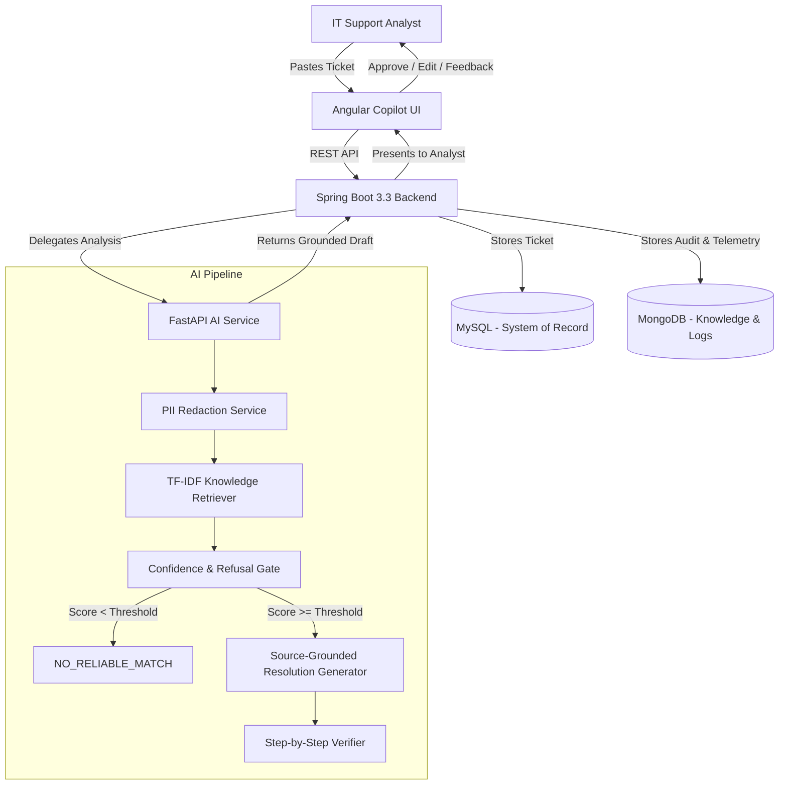

# 🏗️ TicketIQ — Architecture & Design

## System Overview

TicketIQ is an evidence-gated, analyst-controlled retrieval copilot for IT AMS ticket classification and resolution.

## Key Architectural Principles

1. **Evidence Gating & Grounding**: No resolution step is presented to the analyst without an exact citation (`sourceArticleId`, `sourceSection`, `sourceStepId`).
2. **Deterministic Refusal**: If a query does not match approved knowledge articles with high confidence, the system refuses to answer (`NO_RELIABLE_MATCH`), eliminating hallucinations.
3. **Dual Storage**:
   - **MySQL**: Relational storage for transactional tickets, status transitions, and audit records.
   - **MongoDB**: Schema-free storage for deep AI telemetry, prompts, embeddings, and confidence scores.
4. **Human-in-the-Loop**: The analyst retains full control to edit, approve, reject, or provide feedback on generated resolution steps.
