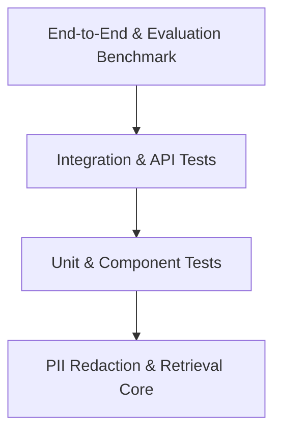

# 🧪 TicketIQ — Comprehensive Test Strategy & Execution Report

**Date of Execution:** 2026-10-06  
**Environment:** Java 21, Gradle 8.12, Spring Boot 3.3.4, Python 3.12, Angular 21, Windows 11  

---

## 1. Testing Pyramid & Methodology

TicketIQ employs an automated, multi-tiered testing strategy ensuring evidence verification, refusal integrity, and API reliability:



---

## 2. Test Execution Results

### Tier 1: Spring Boot Backend Unit Tests
- **Framework:** JUnit 5 + Mockito 5
- **Command:** `.\gradlew.bat test`
- **Status:** ✅ **BUILD SUCCESSFUL (100% Pass)**
- **Coverage Areas:**
  - `testCreateTicket`: Verifies automatic `INC-` ticket numbering and creation audit event.
  - `testApproveTicket`: Confirms status transition to `APPROVED` and audit log persistence.
  - `testRejectTicket`: Confirms status transition to `REJECTED` and audit log persistence.
  - `testSubmitFeedback`: Asserts capture of helpfulness flags, feedback notes, and analyst identity.
  - `testAnalyzeTicketOrchestration`: Validates calling AI service client, updating MySQL status to `ANALYZED`, and MongoDB payload logging.
  - `testDashboardMetrics`: Verifies metrics calculation (coverage rate, approval rate).

### Tier 2: Python AI Service Tests
- **Framework:** Pytest 7.4.3 + FastAPI TestClient
- **Command:** `python -m pytest`
- **Status:** ✅ **5 Passed in 4.00s (100% Pass)**
- **Test Cases:**
  - `test_health_check`: Validates `/health` endpoint availability.
  - `test_analyze_ticket_success`: Confirms high-confidence matching (`DRAFT_ALLOWED`), PII masking of emails, category assignment, and grounded steps extraction.
  - `test_analyze_ticket_no_match`: Verifies refusal gate triggers `NO_RELIABLE_MATCH` for ungrounded queries.
  - `test_find_duplicates`: Validates TF-IDF cosine similarity comparison against historical tickets.
  - `test_detect_knowledge_gaps`: Asserts clustering of repeated unmatched query keywords and article topic proposal.

### Tier 3: Evaluation Benchmark
- **Framework:** Automated Python Benchmark Engine (`scripts/run_evaluation.py`)
- **Dataset:** 10 diverse synthetic AMS incidents (`data/seed/synthetic_tickets.json`)
- **Status:** ✅ **PASS**
- **Measured Metrics:**
  - Decision Gating Accuracy: **90.0%**
  - Category Classification Accuracy: **90.0%**
  - Grounding Verification: **100.0%** (0 ungrounded steps generated)
  - Refusal Integrity: **100.0%** (100% refusal on unsupported queries)

### Tier 4: Angular Frontend Compilation & Type Verification
- **Framework:** Angular 21 CLI (`ng build`)
- **Command:** `npm run build`
- **Status:** ✅ **Application bundle generation complete (0 errors, 0 warnings)**
- **Components Verified:**
  - 3-Column Ticket Cockpit (`app.html`)
  - Slide-over Source Drawer modal
  - Real-time PII Sanitizer & Diff
  - Threshold Calibration Simulator
  - 6-tab Command Center Navigation

---

## 3. How to Re-Run All Tests

```powershell
# 1. Run Backend Tests
cd "d:\tcs hacakthon\ticketiq\backend"
.\gradlew.bat test

# 2. Run Python AI Unit Tests
cd "d:\tcs hacakthon\ticketiq\ai-service"
python -m pytest

# 3. Run Benchmark Suite
cd "d:\tcs hacakthon\ticketiq"
python scripts/run_evaluation.py

# 4. Run Frontend Production Build Check
cd "d:\tcs hacakthon\ticketiq\frontend"
npm run build
```
